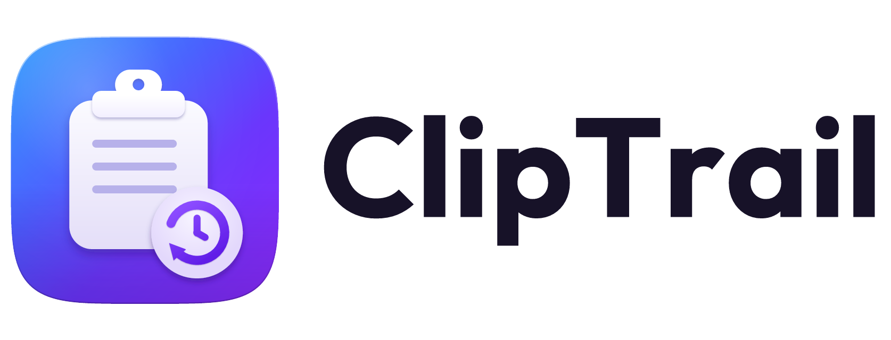
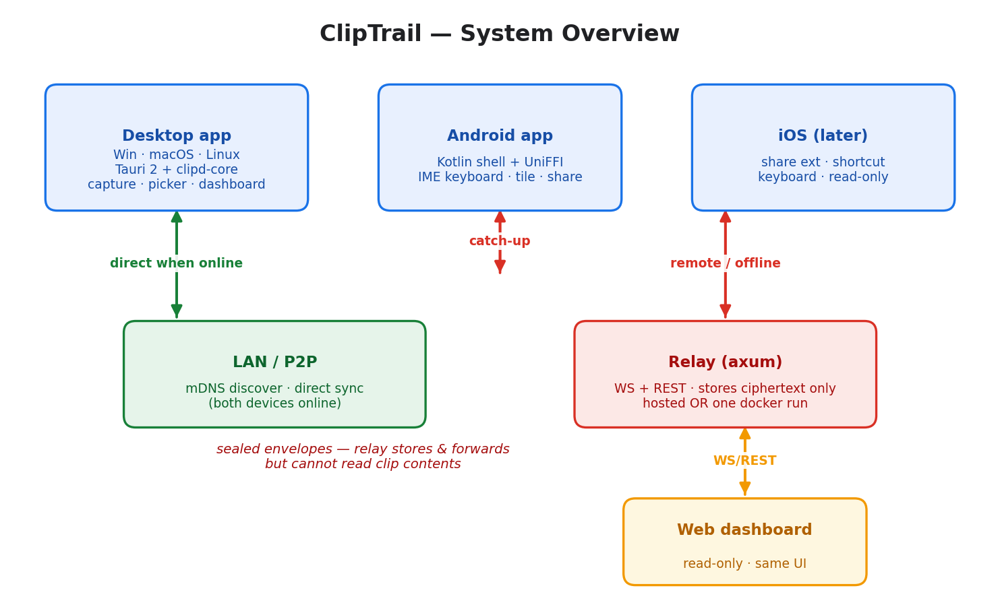

<p align="center">
  
</p>

# ClipTrail

**Your clipboard, everywhere, forever.** An open-source, end-to-end-encrypted clipboard history that captures everything you copy, organizes it automatically, and syncs it across Windows, macOS, Linux and Android — so the link from last Tuesday or the code you copied on your phone is always one hotkey away.

> **Status: pre-alpha, v1 in active development.** Working today: the Rust core, Windows clipboard capture, the `clipd` CLI and the Windows desktop app (dashboard, quick picker, tray). In progress: encrypted laptop ↔ phone sync and the Android app. Linux capture is written and CI-checked but not yet tested on a real session. Website: <https://abhijitdalal26.github.io/cliptrail/> · Docs: <https://abhijitdalal26.github.io/cliptrail/docs/>

## Try it (from source)

Installers will be attached to [Releases](https://github.com/abhijitdalal26/cliptrail/releases) from v0.1.0. Until then:

```sh
# Requirements: Rust (pinned via rust-toolchain.toml), Node 22 + pnpm, and on Windows the
# MSVC build tools; on Linux the Tauri system packages (see .github/workflows/ci.yml).

# Desktop app
cd apps/desktop
pnpm install
pnpm tauri dev          # or: pnpm tauri build

# Command-line tool
cargo run -p clipd-cli -- watch           # capture everything you copy (Ctrl+C to stop)
cargo run -p clipd-cli -- search "deploy" # substring search over your history
cargo run -p clipd-cli -- list --kind link
cargo run -p clipd-cli -- stats
```

Set `CLIPTRAIL_DATA_DIR` to keep a throwaway history while experimenting. The quick picker opens with **Ctrl+Shift+Space**; press **?** in the dashboard for every shortcut.

## Why another clipboard app?

Existing tools split into two camps: **great history, one machine** (Ditto, Maccy, Paste) or **sync without history** (KDE Connect, Phone Link, universal clipboards). Nothing gives you deep, organized, searchable history that follows you across ecosystems. ClipTrail does — and it's open source so you can audit every byte or self-host the relay.

## What it does

- Captures every copy — text, links, code, images, files — nothing lost after 25 items or a reboot
- Auto-sorts into categories (link, code, note, contact, image, sensitive) with zero tagging
- Browse back through time — timeline view, date scrubber, calendar heatmap
- Instant full-text search with filters (category, date, device, source app)
- End-to-end encrypted sync — the relay stores ciphertext it cannot read
- Two-keystroke paste: hotkey → pick a section → Enter restores focus and pastes
- Self-host the relay with one `docker run`, or use the hosted service out of the box
- Sensitive-clip hygiene: skips password managers, detects OTPs/keys, auto-expiry

## Docs

| Doc | What's in it |
| --- | --- |
| [docs/product-spec.md](docs/product-spec.md) | The original product spec — goals, data model, classifier, dashboard, Android capture |
| [docs/market-research.md](docs/market-research.md) | What users say about every existing tool + the feature asks that keep recurring |
| [docs/technical-blueprint.md](docs/technical-blueprint.md) | Tech stack, codebase study notes, feature priorities, UI design, technical landmines |
| [docs/system-design.md](docs/system-design.md) | Architecture: components, capture pipeline, data model, sync protocol, crypto, platform matrix |
| [docs/build-plan.md](docs/build-plan.md) | The 3-day MVP plan and this repo's structure |
| [docs/reference-codebases.md](docs/reference-codebases.md) | External repos to study — what each teaches, license, reuse vs read-only |
| [docs/feature-candidates.md](docs/feature-candidates.md) | Final sweep: missed products + every user ask, marked A/B/C for review |
| [docs/android-plan.md](docs/android-plan.md) | Android v1: capture without a custom keyboard, architecture, LAN sync sketch, milestones |

## Architecture



```
crates/clipd-core      clip model · SQLite + FTS5 trigram search · classifier · transforms · capture pipeline
crates/clipd-capture   OS clipboard watcher, write-back and paste-back (Windows; Linux X11/Wayland)
crates/clipd-cli       the `clipd` command-line tool
crates/clipd-mcp       MCP server: lets AI agents search your clipboard history
apps/desktop           Tauri 2 app: dashboard, quick picker, tray (Windows, Linux; macOS experimental)
apps/android-spike     Android capture experiment (accessibility trigger, no custom keyboard)
site/                  the project website (GitHub Pages)
```

One Rust core shared by every client · Tauri 2 + React desktop · encrypted sync with QR pairing (in progress) · no telemetry.

## License

Dual-licensed under [MIT](LICENSE-MIT) or [Apache-2.0](LICENSE-APACHE) — pick whichever works for you.
