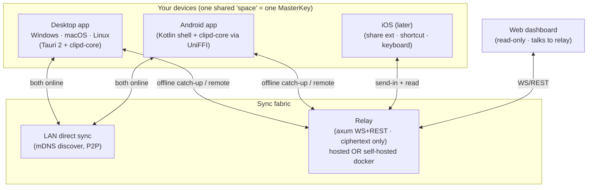
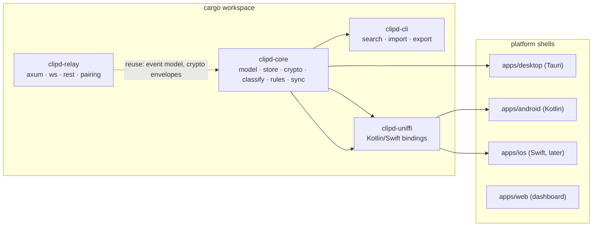
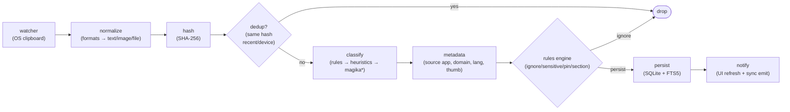
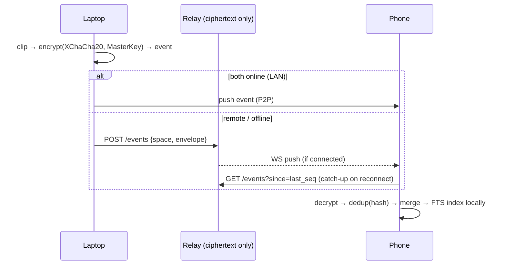

# ClipTrail — System Design

The engineering document: components, data flow, storage, sync, crypto, and platform specifics. Read after `docs/product-spec.md`; decisions are justified in `docs/technical-blueprint.md`.

## 1. Big picture



Design rules that everything else follows:

1. **One Rust core** (`clipd-core`) holds all logic; platform code is thin shells.
2. **The relay is dumb** — store-and-forward ciphertext. It can see metadata (timestamps, device ids, sizes), never content.
3. **Local-first**: capture, classify, search, dashboard all work fully offline; sync is an add-on, never a dependency.
4. **P2P when possible, relay as fallback**: direct LAN/cross-network sync when both devices are reachable; the relay is an encrypted mailbox for everything else.

## 2. Crate / app layout



- `clipd-core` — pure Rust, no UI deps. The only place that knows the clip model, SQLite schema, crypto, classifier, rules engine, and the sync event format.
- `clipd-relay` — axum server. Persists opaque event envelopes + pairing/device registry. Could embed in the desktop app ("bundled mode", per clipper) for LAN-only users.
- `clipd-cli` — debug/import/export tool; also the migration path (Ditto/CopyQ importers).
- `clipd-uniffi` — generated Kotlin/Swift bindings over a stable FFI surface (capture-notify, append-clip, search, list, paste).

## 3. Capture pipeline (per device)



- **Watcher** polls (250–500 ms) or hooks the OS clipboard and emits raw formats (text, html, rtf, png, file-list, uri).
- **Normalize** reduces to `text | image | file-ref` + keeps the richest useful representation (e.g. HTML keeps its text + source URL).
- **Dedup** on `content_hash` — same content copied twice, or arriving via sync from another device, collapses to one clip (bump `last_seen_at`, merge `device_ids`).
- **Classify** assigns `kind` (link/code/note/contact/file/image/sensitive) + `subkind` (domain, language, hex-color…). Rules engine runs *after* classification and can override (user-learned rules) or drop (ignore rules, sensitive patterns).
- Sensitive clips are either skipped or stored `masked` with short `expires_at` — never synced in the clear anywhere including the local DB.

**What "capture across everything" means:** the watcher observes the *system* clipboard, not apps. Anything that lands there — terminal selections, Chrome copies, PDF text, IDE snippets, screenshots — is captured, tagged with the source app when the OS exposes it. Only two carve-outs: apps that set the concealed/transient flag (password managers) are skipped by design, and your per-app blocklist.

## 4. Data model

```sql
clips:
  id            ULID PK            -- sortable by creation time, safe offline
  content_hash  BLOB UNIQUE        -- dedup key (sha256)
  kind          TEXT               -- link|code|note|contact|file|image|sensitive
  subkind       TEXT               -- github.com | rust | color | screenshot…
  captured_at   INTEGER            -- UTC unix ms
  device_id     TEXT               -- which device copied it
  source_app    TEXT               -- when the OS reports it
  text          BLOB               -- body (encrypted at rest)
  thumb         BLOB               -- small thumbnail for images
  file_path     TEXT               -- original path when it exists (no duplication)
  title         TEXT               -- link page title / derived summary
  section_id    TEXT NULL          -- user folder
  pinned        INTEGER
  masked        INTEGER            -- sensitive: show •••• until revealed
  expires_at    INTEGER NULL
  deleted_at    INTEGER NULL       -- tombstone (sync deletes)

clips_fts (FTS5):  text, title, ocr_text        -- external-content, kept local per device
rules:             id, conditions(json), action, learned_from, enabled
devices:           device_id PK, name, pubkey, paired_at, revoked_at
sync_events:       seq PK, event_id, device_id, ts, envelope BLOB   -- append-only op log
```

Time axis is `captured_at` — day/week/month grouping, calendar heatmap and date ranges are plain SQL over it.

## 5. Sync protocol

Sync = **replicating an append-only event log** between devices; the relay just stores envelopes per space.

Event types: `ClipAdded`, `ClipUpdated(pin/section/move)`, `ClipDeleted(tombstone)`, `DevicePaired`, `DeviceRevoked`, `SpaceRotated`.



- **Envelope** = `{event_id, device_id, ts, nonce, ciphertext}`; the relay validates shape but can't read it.
- **Echo suppression:** sender writes its own hash into a quiet window so its watcher doesn't re-capture the clip it just pasted/synced (decentpaste pattern).
- **Deletes propagate** as tombstones; content is wiped, not just hidden.
- **Conflicts:** last-writer-wins on `pinned/section/deleted`; clip bodies are immutable so conflicts are rare and cheap.
- **Relay ACL:** each `space` is a bucket; devices authenticate with a per-device bearer token issued at pairing; revoked devices' tokens die immediately.

## 6. Crypto & pairing

- **Space** = the set of your devices. One `MasterKey` (32 B, XChaCha20-Poly1305) encrypts every clip payload and every event.
- **Pairing (new device):** trusted device shows QR = `{invite_code, space_pubkey, relay_url}` → both run X25519 ECDH → derive shared secret → MasterKey transferred wrapped under that secret → new device gets a device token for the relay. No account, no email.
- **Hosted account mode (optional):** account proves ownership for device management/billing; the MasterKey still comes from pairing — login ≠ decryption.
- **Passphrase/KEK:** MasterKey is wrapped by a key derived via Argon2id from an optional passphrase, stored in the OS keychain/keystore (decentpaste's decentsecret pattern).
- At rest: DB encrypted (SQLCipher or AES-GCM on blobs); FTS index stays local per device (it's derived data, re-buildable).

## 7. Platform matrix

| Platform | Capture | Paste-back | Capture source-app? | Shell |
| --- | --- | --- | --- | --- |
| Windows | system clipboard watcher | foreground-restore + SendInput (Recopy recipe) | yes (foreground hwnd) | Tauri |
| macOS | pasteboard watcher | NonactivatingPanel + resign key + paste event | yes (NSWorkspace frontmost) | Tauri |
| Linux X11 | watcher (xclip/arboard) | focus restore + synthetic key | partial | Tauri |
| Linux Wayland | wl-clipboard/ext-data-control where supported (GNOME gaps) | compositor-dependent | compositor-dependent | Tauri |
| Android | **IME keyboard** (primary) · overlay/accessibility (sideload) · QS tile + share target (fallback) | inside keyboard strip; other apps paste normally | limited | Kotlin + UniFFI |
| iOS | share extension · Shortcut · custom keyboard · capture-on-open (no background reads — OS restriction) | copy-back to clipboard | no | Swift + UniFFI (later) |
| Web | none (read-only) | — | — | shared UI build |

## 8. Search & dashboard (client-side)

- **FTS5** over `text + title + ocr_text`; filters on `kind, subkind, device_id, source_app, date range, section, pinned`.
- **Timeline**: `GROUP BY date(captured_at)` → day/week/month headers; virtualized list (~20 DOM nodes at 10k clips).
- **Calendar heatmap**: `SELECT date, count(*) GROUP BY date` → click a day to jump.
- **Cards per kind**: link (favicon+title+domain), code (syntax-highlight, collapsed), image (thumb+path), note (first lines), sensitive (masked ••••).
- OCR (P1) extracts text from image clips into `ocr_text` so screenshots are searchable.

## 9. Failure modes & rules

- **Offline**: everything works except sync; events queue and replay (`since=seq`) on reconnect.
- **Relay down**: P2P still works on LAN; remote queues until relay returns.
- **Revoked/lost device**: revoke → its relay token dies; SpaceRotated re-keys if needed.
- **Database corruption**: `clipd-cli export` JSON backup; FTS is rebuildable.
- **Echo loops**: content-hash dedup + quiet window + sender-id check.
- **Battery-killed Android service**: foreground service + boot receiver + onboarding screen per OEM; keyboard path unaffected (IME is always resident).

## 10. Security model (summary — see SECURITY.md)

| Guarantee | How |
| --- | --- |
| Relay can't read clips | XChaCha20 per-event, keys on devices only |
| Passwords not stored | concealed flags honored + shape detection + preset app exclusions |
| Server compromise | yields ciphertext + metadata only |
| Local theft | DB encrypted at rest; masked sensitive entries; optional passphrase lock |
| No analytics | zero telemetry — auditable because the code is open |

## 11. Build order

Day 1: core (model/store/crypto/classifier/rules) + CLI. Day 2: desktop picker + dashboard + paste-back. Day 3: relay + pairing + two-device sync + web dashboard. Then Android shell → hosted accounts → iOS → OCR/stack/snippets. See `docs/build-plan.md`.
